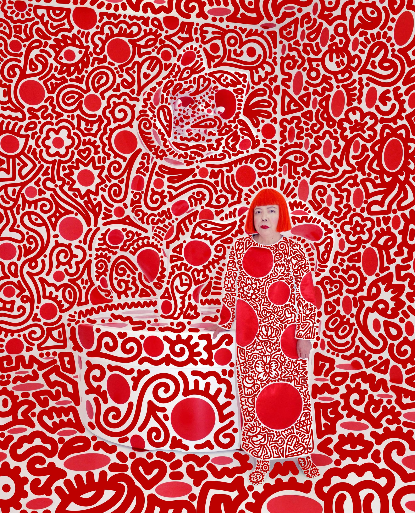

# Continuous to Discrete

This is the first test essay for Prismary. It exists as a markdown file in the essays directory and is rendered to a simple HTML page for testing the directory structure.

  

  Image attribution: <a href="https://hyperallergic.com/the-art-world-reacts-to-yayoi-kusamas-passing/" target="_blank" rel="noreferrer noopener">Hyperallergic</a>

## Why this matters

The site is meant to behave like a clean archive of short notes, observations, and visual essays. Each item should be easy to find, easy to read, and easy to extend later.

## Notes

- Minimal index landing page
- Static HTML output
- Easy to add more essays later
- Keeps the overall visual system restrained and clear
